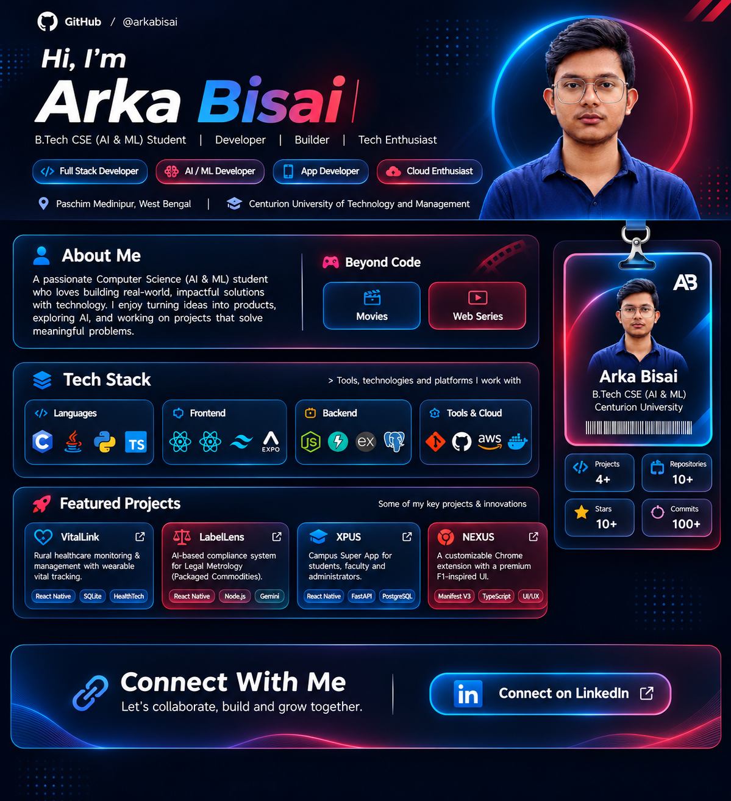

<!--
  ARKA BISAI — GitHub Profile README
  Keep the assets/ folder beside this README.md in your profile repository.
-->

  

  

---

## About Me

I'm **Arka Bisai**, a B.Tech Computer Science & Engineering student specializing in **Artificial Intelligence & Machine Learning**. I enjoy building practical software, exploring AI, and turning ideas into useful digital experiences.

- 🎓 B.Tech CSE (AI & ML) — Centurion University of Technology and Management
- 📍 Paschim Medinipur, West Bengal
- 💻 Interests: Full-stack development, AI/ML, app development and cloud technologies
- 🎬 Beyond code: Movies and web series

## Featured Projects

| Project | Description | Repository |
|---|---|---|
| **VitalLink** | Rural healthcare monitoring and management platform with offline-first workflows. | Under development(#) |
| **LabelLens** | AI-assisted packaged-commodity label analysis with deterministic Legal Metrology compliance checks. | https://github.com/arkabisai/LebelLens(#) |
| **XPUS** | Campus super app for students, faculty and administrators. | Under development(#) |
| **NEXUS** | A customizable Chrome new-tab experience with a premium F1-inspired design. | Under development(#) |

## Technology Stack

**Languages:** Python · Java · JavaScript · TypeScript

**Frontend & Mobile:** React Native · Expo · HTML · CSS

**Backend & Databases:** FastAPI · Node.js · Express · PostgreSQL · MySQL · SQLite

**Tools & Cloud:** Git · GitHub · Firebase · AWS · VS Code

---

  

  Let's collaborate, build and grow together.

